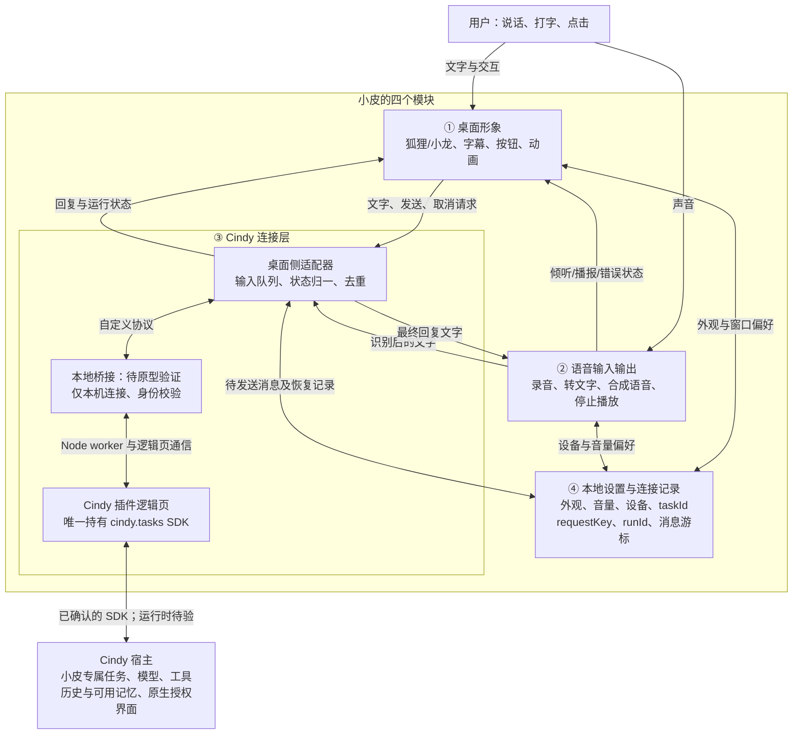

# 小皮：Cindy 连接层与四模块边界

核对日期：2026-10-15。定位：小皮是 Cindy 的桌面化身；狐狸、小龙共享同一对话入口。

## 结论与证据等级

建议通过 Cindy 插件持有小皮专属普通任务，桌面程序经本地桥接与插件交换消息。

本次已读取当前运行宿主返回的 Ghost 编写手册 §4.11.3、§4.12、§4.6、§5、§6，并查询 cindy_helper 能力目录。下文“已确认”指当前宿主官方手册明确支持，不表示完成接口实测。

本次没有创建或安装插件，没有创建任务、派发消息或调用收费模型，也没有改动现有外观程序。插件 SDK 的 capabilities() 只能在相应插件上下文调用，本次未取得其运行时返回值。实现前必须以该返回值确认可用操作。

尚未确认可供独立桌面程序直接使用的公开 HTTP/WebSocket 会话 API。不能把 Agent 可调用的 cindy_helper MCP 工具，当成桌面程序可以直接调用的通用 SDK。

## 已确认的 Cindy 插件接口

声明 `"agent": { "tasks": true }` 后，插件逻辑页使用 `cindy.tasks`。这是独立权限，仍受宿主授权控制。

| 操作 | 接口 | 关键边界 |
| --- | --- | --- |
| 探测能力 | `capabilities()` | 每次连接后核实 operations；不凭版本号推测 |
| 模型目录 | `models()` | 返回 route、efforts 等；不自动换模型或账号 |
| 创建专属任务 | `create({ requestKey, title })` | 仅创建本插件拥有的本机普通任务 |
| 恢复及查看任务 | `get` / `list` | 只允许本插件自有任务；完整参数待 SDK/原型核对 |
| 发送文字 | `send({ taskId, expectedRevision, requestKey, text })` | 复用 taskId 延续上下文；revision 防止并发覆盖 |
| 查询执行 | `getRun({ runId })` / `listRuns` | 以执行状态判断完成；不能看到一条回复就当完成 |
| 读取消息 | `readMessages({ taskId, limit, after? })` | 保存 nextCursor，后续以 after 继续；非 token 流订阅 |
| 取消一次输入 | `cancel` | 只取消相应输入，不得误停后来输入；完整参数待核对 |
| 修改模型 | `setModel` | 需能力支持、用户选择及版本校验；第一版不必开放 |

SDK 成功返回 data；失败抛带 code 的错误。底层响应是 `{ok:true,data}` 或 `{ok:false,error:{code,message,retryable}}`。

create/send 的 requestKey 持久去重，同键不同内容拒绝。任务删除后不自动重建。taskId、runId、requestKey 与消息游标都需要保存。

运行态可能返回 `reconciling`：表示正在对账，不能当成功或失败，也不能自动换键重发。outputMessageId 来自产品终态，完成播报优先按其定位最终回复。

### 不能作出的承诺

- 普通任务接口暂不支持接管任意已有会话、远程任务、伙伴任务或事件订阅。当前架构会新建小皮专属任务，不能直接绑定当前架构讨论会话。
- 这些插件自有任务及其 Worker 不提供账号级历史与跨任务控制；`cindy_memory.session_search` 也拒绝历史检索。不能宣称小皮天然记得其他会话。
- 上述限制不等于所有长期记忆均不可用。Maker Memory 的具体读写能力、工作目录范围与跨重启注入，需要在专属任务中分别验证。
- SDK 暂未提供全部恢复路径的最终对账和事件补拉；恢复不确定时保留现场并提示用户查看 Cindy，不能保证完全自动恢复。
- 任务权限由插件任务设置决定，缺省 ask，不继承当前对话的权限；用户确认和补充输入在第一版回到 Cindy 原生界面处理。
- 没有验证实时 token 传输、说话打断或任意并行聊天能力。第一版每次只发送一条输入，后续输入在本地排队。

### 其他接口为何暂不作为主链路

`cindy.agent.run` 支持继续/分叉/新建，但通常绑定真实卡片点击票；background 模式另有会话关联与频控限制，不是任意语音消息的通用入口。

旧 `errand/queryErrand` 有并发、间隔及短期结果保留限制，手册推荐新插件使用普通任务 API。

`oneshot_text` 不进入会话、没有工具，不适合直接承担长期陪伴主对话。

通用 subscribe 的 turn/activity 元数据与普通任务 API 的订阅能力不是同一回事。不能据此推断插件自有任务一定会收到事件；首版采用 getRun/readMessages。

## 四个模块的边界

模块①只呈现状态、收集交互，不调用 Cindy SDK，不以动画推断执行成功。

模块②只处理声音与文字，不决定任务路由，不维护另一套人格。停止播放仅停止 TTS；取消 Cindy 执行是不同动作。

模块③统一处理 taskId、请求键、队列、连接错误与回复归属。内部包含桌面适配器和 Cindy 插件两端，不能画成一个外部 SDK 调用就假定链路已完成。

模块④保存偏好和恢复所需的最少记录，不另建长期人格记忆库。Cindy 保存的消息是对话事实来源；本地只缓存必要待发送文本，发送成功后按策略清理。

待机/倾听/播报来自本地交互及音频状态；Cindy 执行态只表示正在处理，不表示已获得真实思考内容。等待授权与等待输入仅在接口有明确证据时展示，否则提示“请在 Cindy 查看”。外观切换不改变任务身份。

## 本地桥接：设计建议，尚非现成接口

§4.12 确认支持随包 Node worker、JSON-RPC stdio、node-notification，并允许经插件逻辑页调用宿主能力。Node worker 不能直接取得 cindy.tasks、Electron IPC 或 Agent 会话。

建议由 Node worker 提供只监听 127.0.0.1 的本地服务，桌面程序接入；请求经 worker 通知逻辑页，再由逻辑页调用 SDK，结果按请求编号返回。传输形式可在原型中选择本机 WebSocket 或 HTTP，不暴露局域网端口。

需要验证：无在途 Agent tool-call 时 worker 通知能否唤起这条处理链、逻辑页/worker 常驻生命周期、暂停与退出、身份校验、端口发现、配置保存及断线回收。Node worker 有当前系统账号的原生权限，不能把它描述为文件沙箱。

## 小皮内部接口草案

以下名称属于我们拟定的连接层，不是 Cindy 已有 API。

| 内部操作/事件 | 含义 |
| --- | --- |
| `connect()` | 建桥、核实 SDK 能力、恢复绑定任务 |
| `sendText({ messageId, text })` | 使用稳定 messageId 派生 requestKey，提交一次用户输入 |
| `cancelTurn({ runId })` | 请求取消指定输入，与停止语音播放分开 |
| `connection.changed` | 连接中、已连接、断开、待对账 |
| `turn.changed` | 排队、执行中、完成、失败、已取消；由真实响应映射 |
| `reply.ready` | 最终回复文字与来源消息标识，用于字幕与一次性播报 |
| `attention.required` | 能确认时提示回 Cindy 完成授权或补充信息 |

每个事件携带可取得的 messageId/taskId/runId 和本地事件编号。reply.ready 要按来源消息去重，防止重连后重复播报。Cindy 原生状态枚举待运行时核对，不把上面内部状态当成 SDK 原值。

## 一条消息的处理顺序

1. 首次使用先获插件任务权限；检查 capabilities，再创建专属任务并保存 taskId。后续启动用 get 恢复；不因短暂断线新建任务。
2. 识别完成，先保存 messageId 和 requestKey，再用 get 取得当前 revision，调用 send。
3. 保存 runId，轮询 getRun 与分页 readMessages。建议运行时约 1–2 秒一次，错误后退避；这是本项目建议，需原型测量，不是官方频率承诺。
4. 收到有依据的终态后定位最终回复，去重交给字幕/TTS。中间进度可显示，不默认整段朗读。
5. 超时/断线先核对原 requestKey 和 run 状态；不自动换键重发。reconciling 保持待对账，任务不存在则交给用户决定是否新建。

## 最小验证清单

1. 在测试插件中取得 capabilities，记录实际支持项和 SDK 返回字段。
2. 经桌面桥接发一条文字到专属任务，取得 runId、真实终态与最终回复。
3. 连续两轮验证上下文；关闭重开 Cindy 与桌面端后恢复同一 taskId。
4. 在响应丢失时使用同 requestKey 重试，确认不重复派发、不重复播报。
5. 验证取消、拒绝授权、任务删除及 reconciling，确保状态准确且不会自动重发副作用输入。
6. 单独核对 Maker Memory 读写与重启注入；不把上下文连续当作跨会话长期记忆验证。

完成这些验证后才能称为“连接已跑通”。当前交付是有官方接口依据的架构方案。

## 资料入口

- 当前宿主 `ghost_forge_guide`：§4.11.3 普通 Session、§4.12 Node 工作进程、§4.6 订阅、§5 面板、§6 沙箱。
- 当前宿主 `cindy_helper.list_tools`：cindy、control、history 类目。
- 官方开源仓库：https://github.com/makecindy/cindy 。本次接口依据来自当前宿主手册，未把仓库最新分支当作本机版本。
